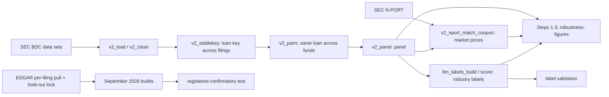

# Private marks, public news: BDC software-loan marks in the 2025-26 software repricing

Code for my MSc thesis in Corporate Finance (Duisenberg Honours Programme, VU Amsterdam, due December 2026).

Thesis title: *Private marks, public news. Did private credit mark down its software loans when the market did?*

**Question.** In early 2026, fears about AI led to a sharp repricing of public software companies and of their traded loans. Business development companies (BDCs) hold billions in private loans to the same kind of borrowers and value each loan themselves every quarter. How much of the public repricing reached those private marks, how fast, and how much depended on a market quote?

**Why it matters.** Supervisors watch private credit as a possible source of systemic risk, partly because funds value most loans without a market price. Investors in non-traded BDCs buy and redeem at reported values. If marks lag market prices, those values are stale exactly when it matters.

The pre-analysis plan is registered on OSF: [doi.org/10.17605/OSF.IO/PSZ5D](https://doi.org/10.17605/OSF.IO/PSZ5D). Results will be added after submission.

## Design

- **Data.** Loan-level schedules of investments of about 140 BDCs from the SEC's BDC data sets (Dec 2022 to Jun 2026, ~420k debt positions), plus SEC Form N-PORT holdings of mutual funds and ETFs, which give a market (Level 2) price for loans that trade.
- **Industry labels.** Funds label industries inconsistently, so every borrower gets a label from an LLM with a fixed prompt, checked against the funds' own labels, a rerun and a blind human-coded sample.
- **Step 1, marks.** Difference-in-differences on positions held on 30 September 2025: software vs other loans in the same fund, before and after the shock, with position and fund x quarter fixed effects. Inference by sector placebos (rank of software among all industry groups), fake shock dates in earlier years and Rambachan-Roth (HonestDiD) bounds.
- **Step 2, same loan, two prices.** The same loan held by a BDC and by a registered fund on the same date: how much of the change in the market price shows up in the BDC mark, quarter by quarter.
- **Step 3, traded vs private.** Software loans whose borrower has a market quote vs borrowers with none, inside the same fund.
- **Hold-out.** The September 2026 quarter was locked in code (`bdc/scripts/edgar/holdout_lock.py`) until after the registered cut-off of 20 November 2026, and is used only for the registered confirmatory test. The September filings were then pulled from EDGAR filing by filing.
- **Checks on the labels.** A second labelling run, a blind hand-coded sample and a relabel by an open-weights model (gpt-oss-20b) run locally at temperature 0.

## Pipeline



| Folder | Contents |
|---|---|
| `bdc/scripts/` | Pipeline and analysis scripts (Python, pandas, statsmodels, scipy, scikit-learn) |
| `bdc/scripts/edgar/` | Per-filing EDGAR pull for the newest quarter and the hold-out lock |
| `bdc/scripts/sep2026/` | The September 2026 confirmatory run |
| `bdc/scripts/draft2/` to `draft7c/` | The scripts that write every number, table and figure of each thesis draft as LaTeX macros (`draft6/run_all_d6.sh` runs them in order) |
| `bdc/scripts/draft7-reruns/` | Survivorship, threshold, common-shock (2020, 2022) and HonestDiD checks (`honestdid_run.R`) |
| `bdc/audit/` | Independent re-computation of the main estimates (code audit) |

## Running

The data are public (SEC) but not included: download the SEC BDC data sets and N-PORT data sets into `raw-sec/` and run the pipeline in the order shown above, then `bash bdc/scripts/draft6/run_all_d6.sh <out folder>` and the scripts in `draft7-reruns/`, `draft7b/` and `draft7c/`. Scripts find data relative to the repository root, or under `THESIS_DATA` if set. The full replication package with the derived data will be published after submission.

```
pip install -r requirements.txt
```

## AI use

I wrote this code together with an AI coding assistant (Claude Code). I set the research design, decided what to estimate, ran and checked the output, and hand-checked the matches that drive results. The thesis has an appendix disclosing this in full.
