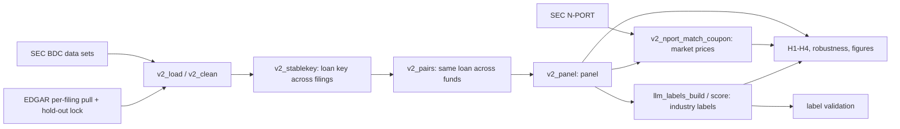

# Private marks, public news: BDC software-loan marks in the 2025-26 software repricing

Code for my MSc thesis in Corporate Finance (Duisenberg Honours Programme, VU Amsterdam, due December 2026).

**Question.** In 2025-26, AI news led to a sharp repricing of public software companies and of their traded loans. Business development companies (BDCs) hold billions in private loans to the same kind of borrowers and report a fair value for each loan every quarter. How much of the public repricing reached those private marks, and how fast?

**Why it matters.** Private credit is now a large part of corporate lending, and investors in non-traded BDCs buy and redeem at reported values. If marks lag market prices, those values are stale exactly when it matters.

The pre-analysis plan is registered on OSF: [doi.org/10.17605/OSF.IO/PSZ5D](https://doi.org/10.17605/OSF.IO/PSZ5D). Results will be added after submission.

## Design

- **Data.** Loan-level schedules of investments of about 140 BDCs from the SEC's BDC data sets (Dec 2022 to Jun 2026, ~420k debt positions), plus SEC Form N-PORT holdings of mutual funds and ETFs, which give a market (Level 2) price for loans that trade.
- **Industry labels.** Funds label industries inconsistently, so every borrower gets a label from an LLM with a fixed prompt, checked against the funds' own labels, a rerun and a blind human-coded sample.
- **H1, marks.** Difference-in-differences on a panel frozen at September 2025: software vs other loans, before and after the shock, with position and fund x quarter fixed effects. Inference by sector placebos (rank of software among all sectors) and fake shock dates in earlier years.
- **H2, same loan, two prices.** The same loan held by a BDC and by a registered fund on the same date: how much of the change in the market price shows up in the BDC mark.
- **Traded vs private.** Software loans whose borrower has traded debt vs borrowers with no market price.
- **Hold-out.** The September 2026 quarter is locked in code (`bdc/scripts/edgar/holdout_lock.py`) and is used only for the registered confirmatory test.

## Pipeline



| Folder | Contents |
|---|---|
| `bdc/scripts/` | Pipeline and analysis scripts (Python, pandas, statsmodels, scipy, scikit-learn) |
| `bdc/scripts/edgar/` | Per-filing EDGAR pull for the newest quarter and the hold-out lock |
| `bdc/audit/` | Independent re-computation of the main estimates (code audit) |

## Running

The data are public (SEC) but not included: download the SEC BDC data sets and N-PORT data sets into `raw-sec/` and run the pipeline in the order shown above. Scripts find data relative to the repository root, or under `THESIS_DATA` if set.

```
pip install -r requirements.txt
```

## AI use

I wrote this code together with an AI coding assistant (Claude Code). I set the research design, decided what to estimate, ran and checked the output, and hand-checked the matches that drive results. The thesis has an appendix disclosing this in full.
